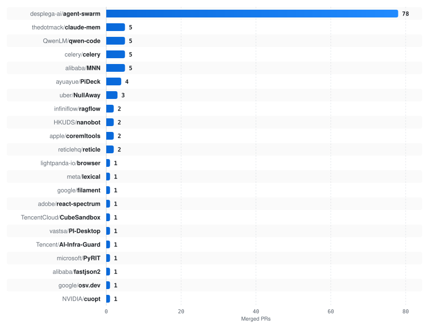

# 

Focus on agent development, agent safety, edge inference, and backend development

## Contribution Activity

  <a href="https://zeding-github-activity-graph.vercel.app">
    <picture>
      <source
        media="(prefers-color-scheme: dark)"
        srcset="https://zeding-github-activity-graph.vercel.app/graph?theme=dark"
      />
      <source
        media="(prefers-color-scheme: light)"
        srcset="https://zeding-github-activity-graph.vercel.app/graph?theme=light"
      />
      
    </picture>
  </a>

## Open Source Contributions

<!--OPEN_SOURCE_CONTRIBUTIONS:start-->

124 merged PRs across 22 upstream projects.

  <picture>
    <source
      media="(prefers-color-scheme: dark)"
      srcset="./assets/open-source-contributions-dark.svg"
    />
    <source
      media="(prefers-color-scheme: light)"
      srcset="./assets/open-source-contributions-light.svg"
    />
    
  </picture>

<!--OPEN_SOURCE_CONTRIBUTIONS:end-->
