<h1>
  <a href="https://git.io/typing-svg">
    <picture>
      <source
        media="(prefers-color-scheme: dark)"
        srcset="https://readme-typing-svg.demolab.com?font=Fira+Code&weight=600&size=26&duration=3500&pause=1000&color=7BA0C4&width=650&height=40&lines=Hi!+I'm+Zeding+Zhang."
      />
      <source
        media="(prefers-color-scheme: light)"
        srcset="https://readme-typing-svg.demolab.com?font=Fira+Code&weight=600&size=26&duration=3500&pause=1000&color=466785&width=650&height=40&lines=Hi!+I'm+Zeding+Zhang."
      />
      
    </picture>
  </a>
</h1>

Focusing on agent development, agent safety, edge inference, and backend systems

## Contribution Activity

<!--CONTRIBUTION_ACTIVITY:start-->

  <a href="https://github.com/ZedingZhang">
    <picture>
      <source
        media="(prefers-color-scheme: dark)"
        srcset="./assets/contribution-activity/activity-dark.svg"
      />
      <source
        media="(prefers-color-scheme: light)"
        srcset="./assets/contribution-activity/activity-light.svg"
      />
      
    </picture>
  </a>

<!--CONTRIBUTION_ACTIVITY:end-->

## Open Source Contributions

<!--OPEN_SOURCE_CONTRIBUTIONS:start-->

164 merged PRs across 24 upstream projects — click any row to open the repository.

<a href="https://github.com/desplega-ai/agent-swarm" title="desplega-ai/agent-swarm — 87 merged PRs (1.1k★)"><picture><source media="(prefers-color-scheme: dark)" srcset="./assets/open-source-contributions/desplega-ai--agent-swarm-dark-ce897711.svg" /><source media="(prefers-color-scheme: light)" srcset="./assets/open-source-contributions/desplega-ai--agent-swarm-light-2bf6aab4.svg" /></picture></a>

<a href="https://github.com/ayuayue/PiDeck" title="ayuayue/PiDeck — 12 merged PRs (1.2k★)"><picture><source media="(prefers-color-scheme: dark)" srcset="./assets/open-source-contributions/ayuayue--pideck-dark-3d06f7ac.svg" /><source media="(prefers-color-scheme: light)" srcset="./assets/open-source-contributions/ayuayue--pideck-light-61d6c2cf.svg" /></picture></a>

<a href="https://github.com/GuillaumeBAUD-coder/open-math-agents" title="GuillaumeBAUD-coder/open-math-agents — 11 merged PRs (33★)"><picture><source media="(prefers-color-scheme: dark)" srcset="./assets/open-source-contributions/guillaumebaud-coder--open-math-agents-dark-da7d5e29.svg" /><source media="(prefers-color-scheme: light)" srcset="./assets/open-source-contributions/guillaumebaud-coder--open-math-agents-light-b4f805db.svg" /></picture></a>

<a href="https://github.com/thedotmack/claude-mem" title="thedotmack/claude-mem — 10 merged PRs (120.2k★)"><picture><source media="(prefers-color-scheme: dark)" srcset="./assets/open-source-contributions/thedotmack--claude-mem-dark-c90beccb.svg" /><source media="(prefers-color-scheme: light)" srcset="./assets/open-source-contributions/thedotmack--claude-mem-light-e1c12858.svg" /></picture></a>

<a href="https://github.com/alibaba/MNN" title="alibaba/MNN — 6 merged PRs (16.6k★)"><picture><source media="(prefers-color-scheme: dark)" srcset="./assets/open-source-contributions/alibaba--mnn-dark-89c65344.svg" /><source media="(prefers-color-scheme: light)" srcset="./assets/open-source-contributions/alibaba--mnn-light-7a399964.svg" /></picture></a>

<a href="https://github.com/QwenLM/qwen-code" title="QwenLM/qwen-code — 5 merged PRs (31.0k★)"><picture><source media="(prefers-color-scheme: dark)" srcset="./assets/open-source-contributions/qwenlm--qwen-code-dark-bb52a38d.svg" /><source media="(prefers-color-scheme: light)" srcset="./assets/open-source-contributions/qwenlm--qwen-code-light-14cc4493.svg" /></picture></a>

<a href="https://github.com/celery/celery" title="celery/celery — 5 merged PRs (29.3k★)"><picture><source media="(prefers-color-scheme: dark)" srcset="./assets/open-source-contributions/celery--celery-dark-5e694ce0.svg" /><source media="(prefers-color-scheme: light)" srcset="./assets/open-source-contributions/celery--celery-light-9540e488.svg" /></picture></a>

<a href="https://github.com/infiniflow/ragflow" title="infiniflow/ragflow — 3 merged PRs (94.8k★)"><picture><source media="(prefers-color-scheme: dark)" srcset="./assets/open-source-contributions/infiniflow--ragflow-dark-00b6889f.svg" /><source media="(prefers-color-scheme: light)" srcset="./assets/open-source-contributions/infiniflow--ragflow-light-a973f697.svg" /></picture></a>

<a href="https://github.com/uber/NullAway" title="uber/NullAway — 3 merged PRs (4.1k★)"><picture><source media="(prefers-color-scheme: dark)" srcset="./assets/open-source-contributions/uber--nullaway-dark-add2ec07.svg" /><source media="(prefers-color-scheme: light)" srcset="./assets/open-source-contributions/uber--nullaway-light-dd347869.svg" /></picture></a>

<a href="https://github.com/bytedance/deer-flow" title="bytedance/deer-flow — 2 merged PRs (85.9k★)"><picture><source media="(prefers-color-scheme: dark)" srcset="./assets/open-source-contributions/bytedance--deer-flow-dark-36f213f8.svg" /><source media="(prefers-color-scheme: light)" srcset="./assets/open-source-contributions/bytedance--deer-flow-light-e32e42f7.svg" /></picture></a>

<a href="https://github.com/HKUDS/nanobot" title="HKUDS/nanobot — 2 merged PRs (50.4k★)"><picture><source media="(prefers-color-scheme: dark)" srcset="./assets/open-source-contributions/hkuds--nanobot-dark-fbce4e20.svg" /><source media="(prefers-color-scheme: light)" srcset="./assets/open-source-contributions/hkuds--nanobot-light-9b01469a.svg" /></picture></a>

<a href="https://github.com/lightpanda-io/browser" title="lightpanda-io/browser — 2 merged PRs (42.7k★)"><picture><source media="(prefers-color-scheme: dark)" srcset="./assets/open-source-contributions/lightpanda-io--browser-dark-461958ff.svg" /><source media="(prefers-color-scheme: light)" srcset="./assets/open-source-contributions/lightpanda-io--browser-light-f35361c2.svg" /></picture></a>

<a href="https://github.com/vastsa/PI-Desktop" title="vastsa/PI-Desktop — 2 merged PRs (8.3k★)"><picture><source media="(prefers-color-scheme: dark)" srcset="./assets/open-source-contributions/vastsa--pi-desktop-dark-66c4edb0.svg" /><source media="(prefers-color-scheme: light)" srcset="./assets/open-source-contributions/vastsa--pi-desktop-light-5dfa865b.svg" /></picture></a>

<a href="https://github.com/apple/coremltools" title="apple/coremltools — 2 merged PRs (5.5k★)"><picture><source media="(prefers-color-scheme: dark)" srcset="./assets/open-source-contributions/apple--coremltools-dark-91efee63.svg" /><source media="(prefers-color-scheme: light)" srcset="./assets/open-source-contributions/apple--coremltools-light-97acdfd9.svg" /></picture></a>

<a href="https://github.com/google/osv.dev" title="google/osv.dev — 2 merged PRs (3.1k★)"><picture><source media="(prefers-color-scheme: dark)" srcset="./assets/open-source-contributions/google--osv-dev-dark-13db1ead.svg" /><source media="(prefers-color-scheme: light)" srcset="./assets/open-source-contributions/google--osv-dev-light-51866f56.svg" /></picture></a>

<a href="https://github.com/reticlehq/reticle" title="reticlehq/reticle — 2 merged PRs (1.3k★)"><picture><source media="(prefers-color-scheme: dark)" srcset="./assets/open-source-contributions/reticlehq--reticle-dark-41ee14e1.svg" /><source media="(prefers-color-scheme: light)" srcset="./assets/open-source-contributions/reticlehq--reticle-light-5cc60235.svg" /></picture></a>

<a href="https://github.com/meta/lexical" title="meta/lexical — 1 merged PR (24.1k★)"><picture><source media="(prefers-color-scheme: dark)" srcset="./assets/open-source-contributions/meta--lexical-dark-4652f8b5.svg" /><source media="(prefers-color-scheme: light)" srcset="./assets/open-source-contributions/meta--lexical-light-12152862.svg" /></picture></a>

<a href="https://github.com/google/filament" title="google/filament — 1 merged PR (20.8k★)"><picture><source media="(prefers-color-scheme: dark)" srcset="./assets/open-source-contributions/google--filament-dark-b9576a53.svg" /><source media="(prefers-color-scheme: light)" srcset="./assets/open-source-contributions/google--filament-light-25a1bd6d.svg" /></picture></a>

<a href="https://github.com/adobe/react-spectrum" title="adobe/react-spectrum — 1 merged PR (16.1k★)"><picture><source media="(prefers-color-scheme: dark)" srcset="./assets/open-source-contributions/adobe--react-spectrum-dark-d0dd13af.svg" /><source media="(prefers-color-scheme: light)" srcset="./assets/open-source-contributions/adobe--react-spectrum-light-0510e68d.svg" /></picture></a>

<a href="https://github.com/TencentCloud/CubeSandbox" title="TencentCloud/CubeSandbox — 1 merged PR (13.5k★)"><picture><source media="(prefers-color-scheme: dark)" srcset="./assets/open-source-contributions/tencentcloud--cubesandbox-dark-b8ea30d2.svg" /><source media="(prefers-color-scheme: light)" srcset="./assets/open-source-contributions/tencentcloud--cubesandbox-light-a6e99fcd.svg" /></picture></a>

<a href="https://github.com/Tencent/AI-Infra-Guard" title="Tencent/AI-Infra-Guard — 1 merged PR (7.8k★)"><picture><source media="(prefers-color-scheme: dark)" srcset="./assets/open-source-contributions/tencent--ai-infra-guard-dark-8eae340d.svg" /><source media="(prefers-color-scheme: light)" srcset="./assets/open-source-contributions/tencent--ai-infra-guard-light-f69d3702.svg" /></picture></a>

<a href="https://github.com/microsoft/PyRIT" title="microsoft/PyRIT — 1 merged PR (5.1k★)"><picture><source media="(prefers-color-scheme: dark)" srcset="./assets/open-source-contributions/microsoft--pyrit-dark-0ae8267d.svg" /><source media="(prefers-color-scheme: light)" srcset="./assets/open-source-contributions/microsoft--pyrit-light-4419ea11.svg" /></picture></a>

<a href="https://github.com/alibaba/fastjson2" title="alibaba/fastjson2 — 1 merged PR (4.4k★)"><picture><source media="(prefers-color-scheme: dark)" srcset="./assets/open-source-contributions/alibaba--fastjson2-dark-ceea03fe.svg" /><source media="(prefers-color-scheme: light)" srcset="./assets/open-source-contributions/alibaba--fastjson2-light-a8221416.svg" /></picture></a>

<a href="https://github.com/NVIDIA/cuopt" title="NVIDIA/cuopt — 1 merged PR (1.1k★)"><picture><source media="(prefers-color-scheme: dark)" srcset="./assets/open-source-contributions/nvidia--cuopt-dark-c68b02af.svg" /><source media="(prefers-color-scheme: light)" srcset="./assets/open-source-contributions/nvidia--cuopt-light-f05a4d6a.svg" /></picture></a>

<picture><source media="(prefers-color-scheme: dark)" srcset="./assets/open-source-contributions/axis-dark-3d581abe.svg" /><source media="(prefers-color-scheme: light)" srcset="./assets/open-source-contributions/axis-light-eae85ea5.svg" /></picture>

<!--OPEN_SOURCE_CONTRIBUTIONS:end-->
